# Manual de uso de Atelier 60 (para empezar desde cero)

Este manual explica, sin dar nada por sabido, cómo arrancar el programa, diseñar una vivienda, sacar imágenes fotorrealistas y abrir la escena en Blender. Si buscas detalles técnicos, están en [README.md](README.md) y [render-engine/README.md](render-engine/README.md).

---

## 1. Qué es cada cosa

El proyecto tiene **tres piezas**. Conviene entenderlas antes de tocar nada:

| Pieza | Qué es | Dónde se ve |
|---|---|---|
| **Editor (Atelier 60)** | Una página web donde dibujas la casa, colocas muebles y eliges materiales. Muestra el plano en 2D y la casa en 3D a la vez. | En tu navegador (Chrome, Edge…) |
| **Motor de render** | Un pequeño programa que recibe la escena del editor y la manda a Blender para obtener una **imagen fotorrealista**. | En una ventana de terminal (no tiene ventana propia) |
| **Blender** | Programa gratuito de 3D. El motor lo usa "por debajo", sin abrirlo. También puedes abrirlo tú para mirar o retocar la escena. | Ya está descargado dentro del proyecto |

El flujo normal es:

```
Diseñas en el editor  →  pulsas "Generar render Cycles"  →  el motor usa Blender  →  la foto aparece en el editor
```

**Importante:** el editor es quien manda. La casa "de verdad" es la del editor. Lo que cambies a mano en Blender **no vuelve** al editor.

---

## 2. Arrancar el editor

Necesitas tener instalado **Node.js** (versión 22 o superior). Ya lo tienes.

1. Abre una terminal (PowerShell) en la carpeta del proyecto:
   `project-house-rendering` (la carpeta donde descargaste o clonaste el repositorio).
2. Solo la **primera vez** (o si alguien cambia las dependencias), instala lo necesario:

   ```powershell
   npm ci
   ```

3. Arranca el editor:

   ```powershell
   npm run dev
   ```

4. En la terminal aparecerá una dirección, normalmente **http://localhost:5173**. Ábrela en el navegador.

Deja esa terminal abierta mientras trabajas. Para apagar el editor, pulsa `Ctrl + C` en ella.

---

## 3. Recorrido por la pantalla

Al abrir el editor verás la casa de ejemplo. La pantalla tiene siete zonas:

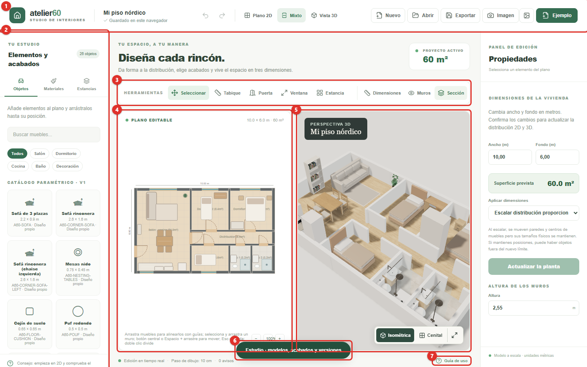

1. **Barra superior**: nombre del proyecto, deshacer, tipo de vista y archivos.
2. **Elementos y acabados** (columna izquierda): el catálogo de muebles, materiales y estancias.
3. **Herramientas**: dibujar paredes, puertas, ventanas y habitaciones.
4. **Plano 2D**: donde dibujas y colocas cosas.
5. **Vista 3D**: la misma casa en 3D. Se actualiza sola.
6. **Estudio**: abre el panel grande con modelos, acabados, versiones y renders.
7. **Guía de uso**: un resumen rápido dentro del propio programa.

A la derecha está el panel **Propiedades** (lo verás en detalle más abajo).

> Las capturas del editor se generan con `node scripts/manual-screenshots.mjs` (con el editor y el motor arrancados) y la de Blender con `scripts/blender-manual-screenshot.py`, así que se pueden rehacer si cambia la pantalla.

### Barra superior

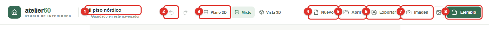

1. **Nombre del proyecto**: haz clic y escríbelo. Debajo se indica si está *Guardado en este navegador*.
2. **Deshacer / Rehacer** (flechas): también con `Ctrl + Z` y `Ctrl + Mayús + Z`.
3. **Plano 2D · Mixto · Vista 3D**: cambia lo que ves. *Mixto* muestra plano y 3D a la vez (es el más cómodo).
4. **Nuevo**: crea un plano en blanco (pide confirmación, porque sustituye el proyecto abierto).
5. **Abrir**: carga un proyecto guardado (archivo `.json`).
6. **Exportar**: guarda tu proyecto en un archivo `.json`. **Hazlo a menudo** (ver apartado 7).
7. **Imagen**: descarga una captura PNG de la vista 3D. El icono de al lado descarga el plano en SVG.
8. **Ejemplo**: vuelve a cargar la casa de ejemplo.

### Barra de herramientas (HERRAMIENTAS)

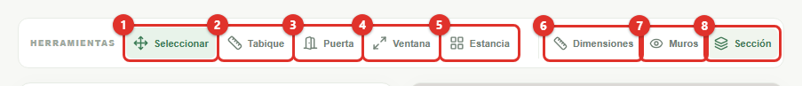

1. **Seleccionar**: haz clic en paredes, muebles, puertas… para moverlos o editarlos.
2. **Tabique**: dibuja una pared marcando dos puntos en el plano.
3. **Puerta** y 4. **Ventana**: haz clic sobre una pared para colocarla.
5. **Estancia**: dibuja una habitación completa.
6. **Dimensiones**: ancho y fondo de la vivienda (ver más abajo).
7. **Muros**: mostrar u ocultar las paredes.
8. **Sección**: corta los muros para mirar dentro en 3D.

### Columna izquierda (Elementos y acabados)

Aquí se añaden los muebles. Tiene tres pestañas: **Objetos**, **Materiales** y **Estancias**.

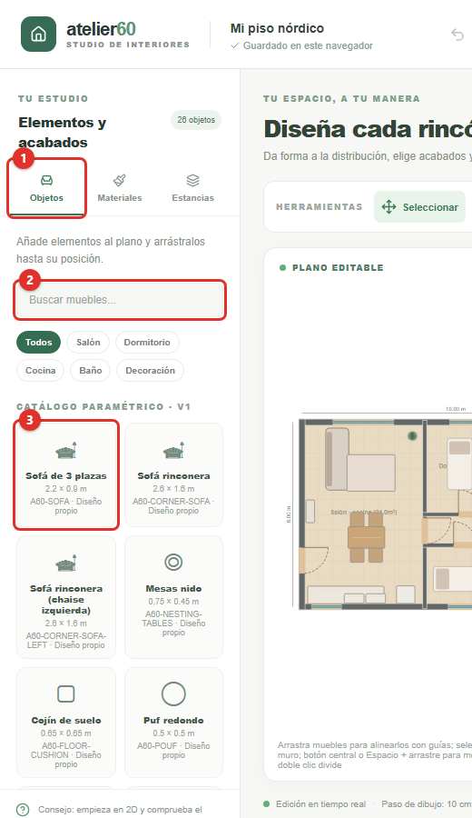

1. Pestaña **Objetos**: el catálogo de muebles.
2. **Buscador**: escribe, por ejemplo, "sofá" o "lámpara". Debajo hay filtros por categoría (Salón, Dormitorio, Cocina…).
3. **Tarjeta de un mueble**: haz clic y el mueble aparece en el plano y en 3D. Después puedes arrastrarlo a su sitio.

### Panel derecho (Propiedades)

Muestra los datos de lo que tengas seleccionado: medidas, giro, color, material, etc. Aquí se cambia todo con precisión. Por ejemplo, tras añadir un sofá:

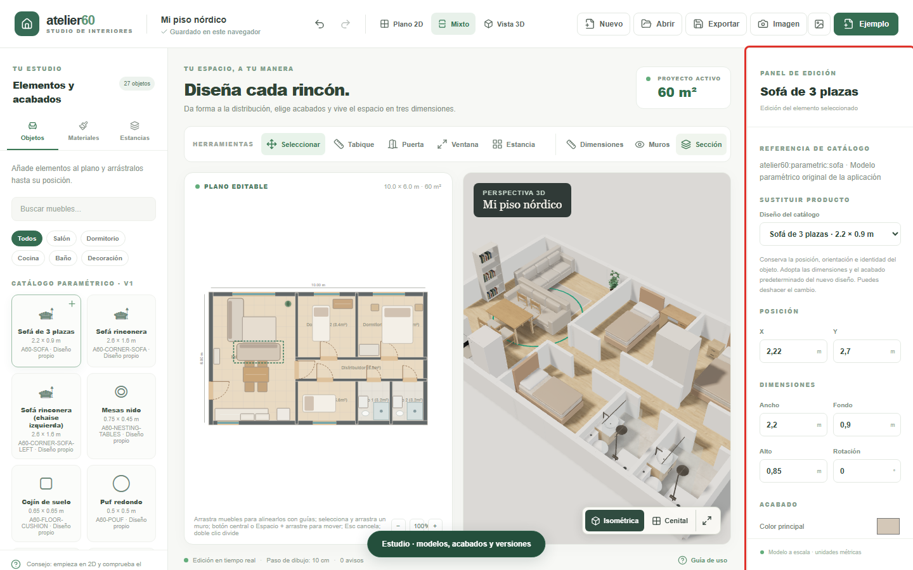

Si no hay nada seleccionado, el panel muestra las medidas de la vivienda y la **altura de los muros**.

### Medidas de la vivienda (botón Dimensiones)

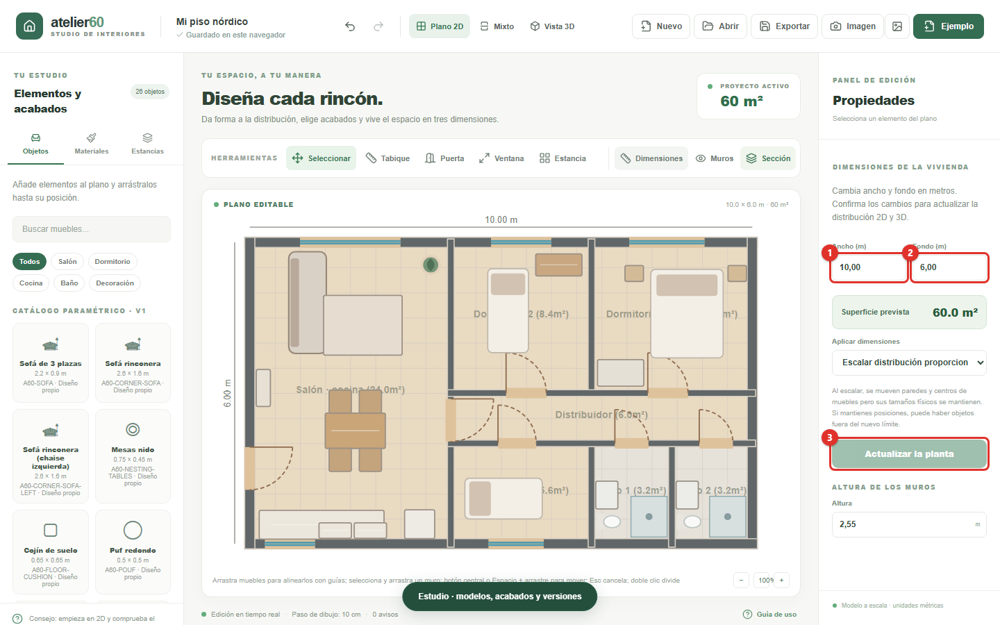

1. **Ancho** y 2. **Fondo** de la vivienda, en metros.
3. **Actualizar la planta**: aplica las medidas nuevas. Justo encima puedes elegir si las habitaciones se escalan o conservan su tamaño.

Más abajo, en el mismo panel, está **Altura de los muros**.

### Botón "Estudio · modelos, acabados y versiones"

Abre un panel grande con pestañas (marcadas en rojo):

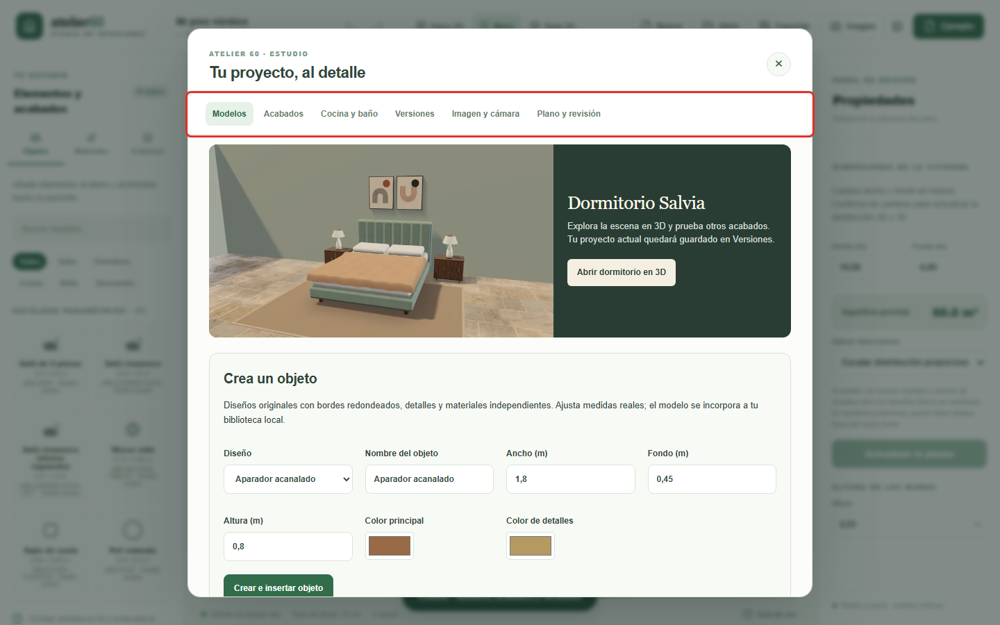

| Pestaña | Para qué sirve |
|---|---|
| **Modelos** | Muebles y objetos 3D incluidos, importar tus propios modelos `.glb` y el *taller de objetos* para crear sofás, camas, mesas… a medida. |
| **Acabados** | Materiales (madera, cerámica, tela, pintura…) y el *taller de materiales* para crear los tuyos. |
| **Cocina y baño** | Muebles de cocina y baño por módulos. |
| **Versiones** | Guardar "fotos" del proyecto para volver atrás o comparar propuestas. |
| **Imagen y cámara** | Luz, encuadre, capturas PNG y el **render fotorrealista con Cycles**. |
| **Plano y revisión** | Precisión del plano, presupuesto en CSV y plano para imprimir. |

Así se ven algunas pestañas:

| Acabados | Cocina y baño |
|---|---|
| 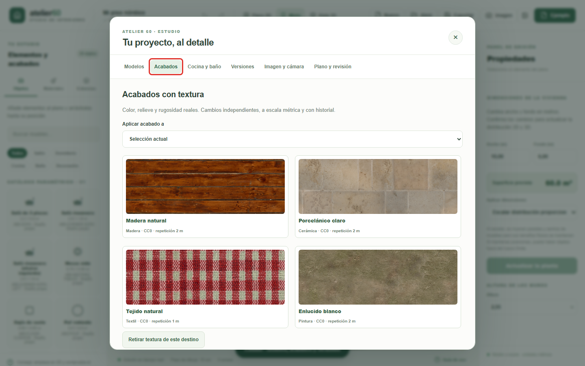 | 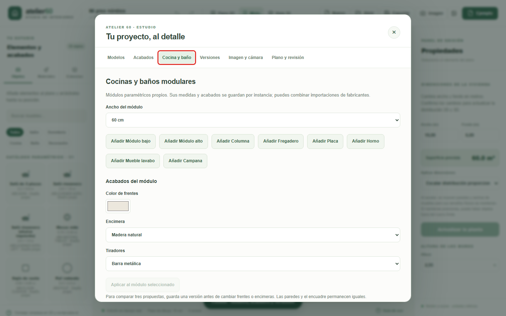 |
| **Versiones** | **Plano y revisión** |
| 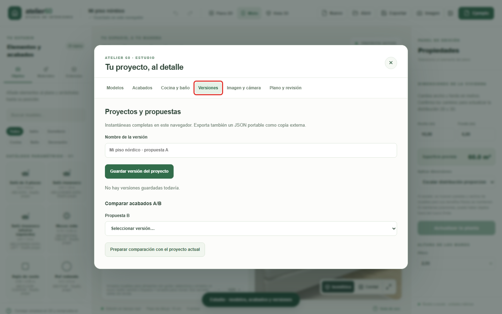 | 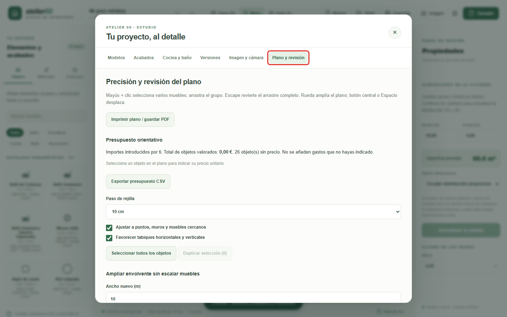 |

Abajo a la derecha del plano está el botón **Guía de uso**, con un resumen rápido:

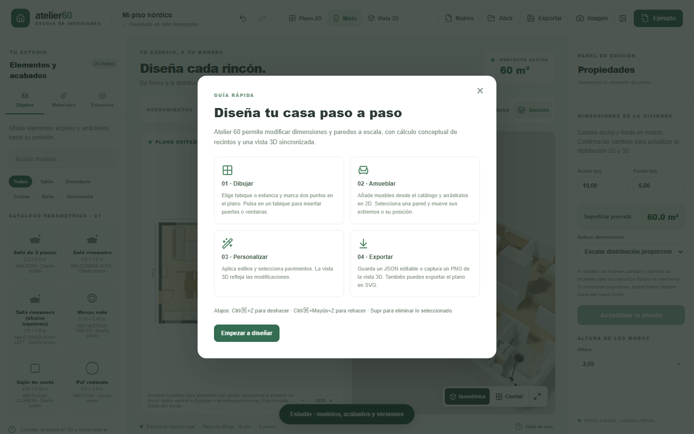

### Moverse por las vistas

- **Plano 2D**: rueda del ratón para acercar; botón central o mantener `Espacio` para desplazar.
- **Vista 3D**: arrastra con el ratón para girar, rueda para acercar.
- `Escape` cancela lo que estés arrastrando. `Supr` borra lo seleccionado.

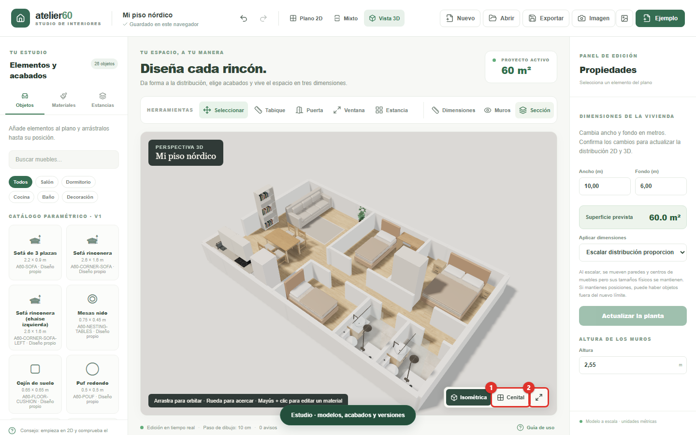

1. **Cenital**: vista desde arriba (al lado, **Isométrica** vuelve a la vista en diagonal).
2. **Pantalla completa**: amplía la vista 3D para presentarla.

---

## 4. Tu primer diseño, paso a paso

1. Pulsa **Nuevo** y acepta: tendrás un plano en blanco.
2. Pulsa **Dimensiones** y, en el panel derecho, escribe el **ancho** y el **fondo**; pulsa **Actualizar la planta**. Ajusta también la **altura de los muros**.
3. Con **Tabique** o **Estancia**, dibuja las habitaciones.
4. Con **Puerta** y **Ventana**, haz clic sobre las paredes para abrir huecos.
5. En la columna izquierda (**Elementos y acabados → Objetos**), haz clic en un mueble para añadirlo. Arrástralo en el plano. Para girarlo o darle medidas exactas, usa el panel derecho. En **Estudio → Modelos** hay más modelos 3D y el taller para crear los tuyos.
6. En **Estudio → Acabados**, elige un material y aplícalo a una habitación, una pared o un mueble.
7. Cambia a **Vista 3D** para revisar cómo queda.
8. Pulsa **Exportar** para guardar una copia.

Consejo: para practicar sin miedo, pulsa **Ejemplo** y modifica la casa de ejemplo. Antes de hacerlo, **exporta** tu proyecto si tienes algo que no quieres perder.

---

## 5. Sacar una imagen fotorrealista (render con Cycles)

Hay dos tipos de imagen:

- **Captura rápida** (botón **Imagen** o *Estudio → Imagen y cámara*): instantánea, se hace en el navegador. Está bien, pero no es fotorrealista.
- **Render con Cycles**: tarda entre unos segundos y unos minutos, pero la luz se calcula como en la realidad. Necesita el motor de render en marcha.

### 5.1 Arrancar el motor de render

Necesitas **Python** (ya lo tienes). Blender ya está descargado en `render-engine\.blender\`.

1. Abre **otra** terminal (deja la del editor abierta) en la carpeta del proyecto.
2. Ejecuta:

   ```powershell
   cd render-engine; python -m atelier_engine
   ```

3. Si todo va bien, queda esperando en `http://127.0.0.1:8765`. Deja esa terminal abierta.

> Si algún día falta la carpeta `render-engine\.blender`, se descarga con
> `python scripts/install_blender.py` (desde dentro de `render-engine`).

### 5.2 Hacer el render

1. En el editor, coloca la vista 3D con el encuadre que quieras (gira y acerca con el ratón).
2. Abre **Estudio → Imagen y cámara** y pulsa **Guardar encuadre actual** (1) para que el render use esa cámara. El botón **Exportar imagen PNG** (2) es la captura rápida del navegador.

   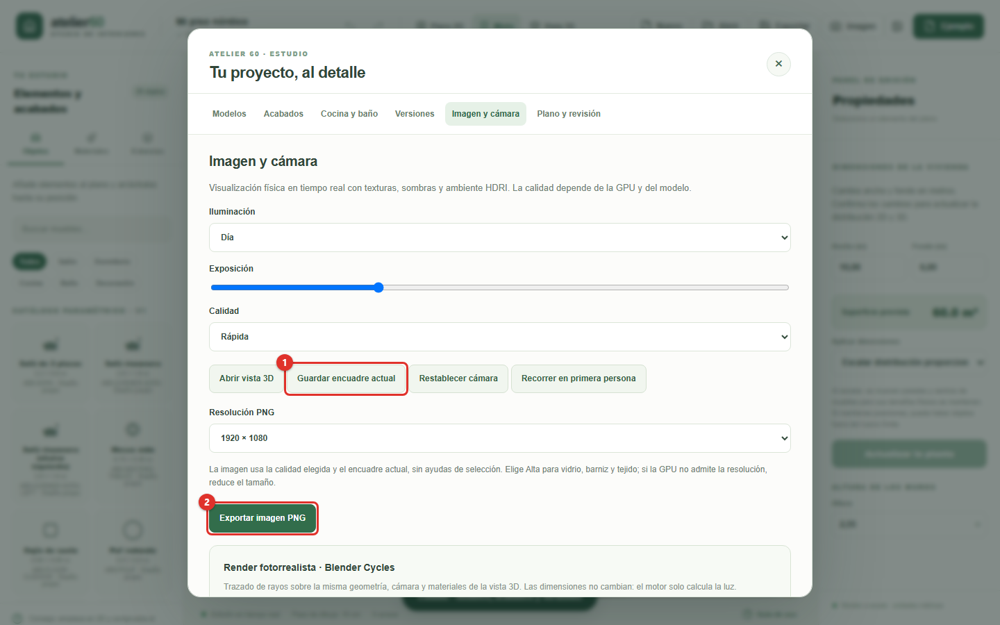

3. Baja hasta **Render fotorrealista · Blender Cycles**. Arriba debe poner **Motor conectado**; si pone *Motor no conectado*, revisa el apartado 5.1 y pulsa **Comprobar**.

   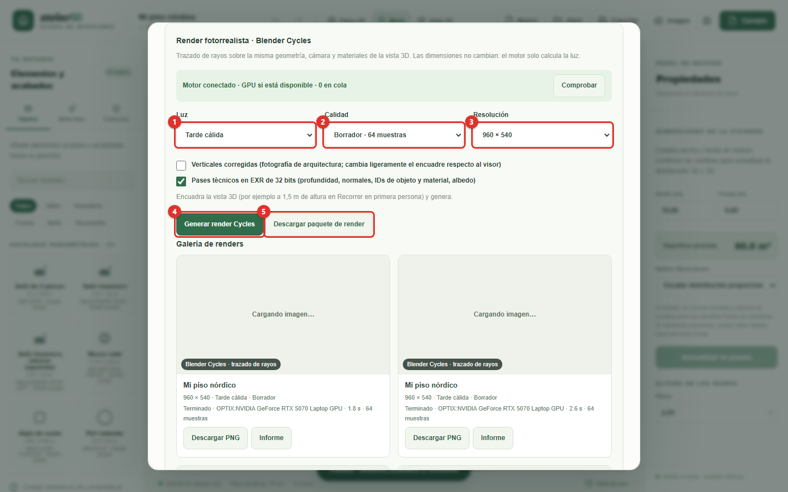

   1. **Luz**: *Tarde cálida*, *Día luminoso*, *Noche con lámparas* o *Estudio HDRI*.
   2. **Calidad**: *Borrador* (rápido, para probar), *Estándar* o *Alta* (lento, para la imagen final).
   3. **Resolución**: el tamaño de la imagen.
   4. **Generar render Cycles**: empieza el render.
   5. **Descargar paquete de render**: descarga la escena para abrirla en Blender (apartado 6).
4. Pulsa **Generar render Cycles**. Mientras trabaja, la tarjeta del render muestra el progreso y un botón para cancelarlo.
5. Cuando termine, la imagen aparece en la **Galería de renders**. **Cycles / WebGL** alterna entre el render y la vista del navegador para compararlas; **Descargar PNG** guarda la imagen.

   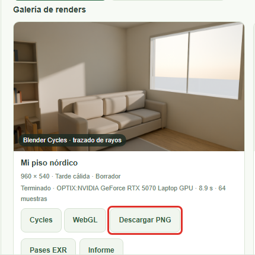

> **Si un render sale negro o gris**, la cámara guardada probablemente está dentro de una pared o detrás de un mueble. Gira la vista 3D hasta ver bien la estancia, pulsa **Guardar encuadre actual** y vuelve a generar. **Encuadrar objeto seleccionado** ya busca una dirección libre de paredes, pero un mueble alto (por ejemplo una estantería) todavía puede quedar delante.

Las imágenes también quedan guardadas en el disco, en
`render-engine\data\jobs\<código del trabajo>\beauty.png`.

---

## 6. Abrir la escena en Blender

Sirve para **mirar la escena en 3D con Blender, retocarla o renderizarla tú mismo**. Recuerda: los cambios hechos en Blender no vuelven al editor.

### 6.1 Conseguir el archivo 3D

Tienes dos opciones:

- **Opción A (sin motor):** en **Estudio → Imagen y cámara**, pulsa **Descargar paquete de render**. Se descarga un `.zip`. Descomprímelo (clic derecho → *Extraer todo*). Dentro hay:
  - `scene.glb` → el modelo 3D completo (paredes, suelos, muebles y materiales).
  - `scene.json` → datos de cámara, luces y habitaciones (lo usa el motor, tú no lo necesitas).
  - `preview.png` → la vista del navegador, como referencia.
- **Opción B (si ya hiciste un render):** el mismo `scene.glb` está en `render-engine\data\jobs\<código del trabajo>\`.

### 6.2 Abrirlo en Blender

1. Abre Blender con doble clic en:
   `render-engine\.blender\blender-4.5.16-windows-x64\blender.exe`
   (o usa tu propio Blender, versión 4.5 o posterior).
2. En la pantalla de bienvenida elige **General**. Borra el cubo inicial: selecciónalo y pulsa `Supr`.
3. Menú **File → Import → glTF 2.0 (.glb/.gltf)**.
4. Busca y elige `scene.glb`. Pulsa **Import glTF 2.0**.
5. Ya tienes la casa. Las piezas aparecen en la lista de arriba a la derecha (*Outliner*).

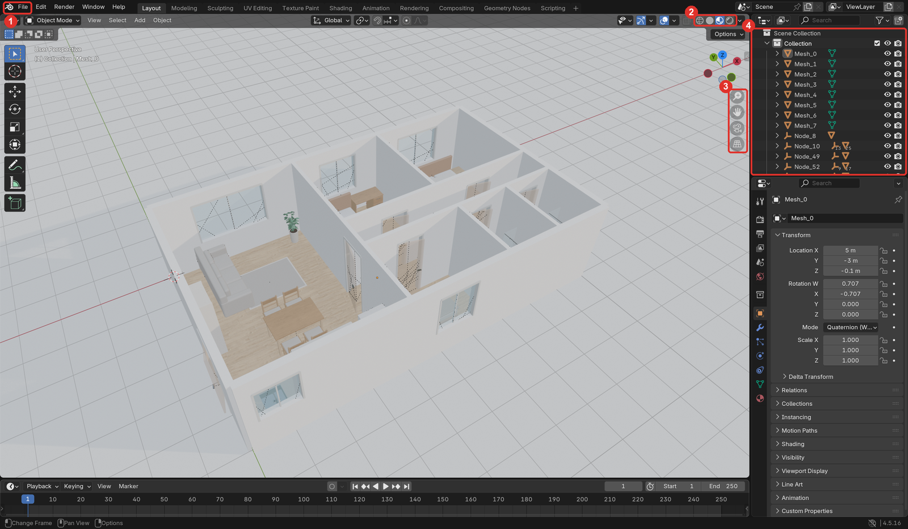

1. Menú **File**: desde aquí se importa (*Import → glTF 2.0*) y se guarda.
2. **Modos de vista**: el tercer círculo (*Material Preview*) muestra los materiales, como en la imagen. El cuarto (*Rendered*) calcula la luz.
3. **Botones para moverse**: lupa (acercar), mano (desplazar), cámara (ver por la cámara) y cuadrícula (perspectiva/ortográfica). Puedes arrastrarlos con el ratón.
4. **Outliner**: la lista de todo lo que hay en la escena. El ojo oculta o muestra cada pieza.

En la imagen, la casa se ve desde arriba para que se entienda; al importarla, Blender puede mostrarla lejos o pequeña: pulsa `Inicio` (*View → Frame All*).

### 6.3 Lo mínimo para moverse en Blender

| Acción | Cómo |
|---|---|
| Girar la vista | Mantener el botón central del ratón y mover |
| Desplazar la vista | `Mayús` + botón central |
| Acercar / alejar | Rueda del ratón |
| Centrar en lo seleccionado | Tecla `.` del teclado numérico (o menú *View → Frame Selected*) |
| Seleccionar | Clic izquierdo |
| Mover / girar / escalar | `G` / `R` / `S`, y luego mover el ratón (clic para confirmar, `Esc` para cancelar) |
| Ver materiales y texturas | Tecla `Z` → *Material Preview* |
| Ver con luz realista | Tecla `Z` → *Rendered* |
| Deshacer | `Ctrl + Z` |
| Guardar tu trabajo de Blender | `Ctrl + S` (crea un archivo `.blend`) |

### 6.4 Qué tendrás y qué no al importarlo a mano

Al importar el `scene.glb` a mano tendrás la **geometría y los materiales básicos**. **No** tendrás lo que el motor añade automáticamente al hacer el render:

- la cámara con tu encuadre,
- el cielo, el sol o las luces de las lámparas,
- los ajustes especiales del vidrio de las ventanas, los visillos, las pantallas de lámpara y las velas.

Por eso, si solo quieres una imagen bonita, **es más fácil usar el botón "Generar render Cycles"** que montar la escena tú en Blender. Abrir en Blender tiene sentido para inspeccionar la escena o para hacer retoques artísticos que el editor no permite.

Si quieres renderizar en Blender a mano, como mínimo añade una luz (*Add → Light → Sun*) y una cámara (*Add → Camera*), activa Cycles en *Render Properties* y pulsa `F12`.

---

## 7. Dónde se guardan tus proyectos (¡lee esto!)

- El editor **guarda solo** en el navegador. En la barra superior verás *Guardado en este navegador*.
- Pero ese guardado vive **dentro del navegador**: si borras los datos de navegación, cambias de navegador o de ordenador, **lo pierdes**.
- Por eso, pulsa **Exportar** de vez en cuando y guarda el `.json` en una carpeta tuya (Documentos, OneDrive…). Para recuperarlo: **Abrir** → elige el `.json`.
- **Estudio → Versiones** guarda "fotos" del proyecto para comparar propuestas o volver atrás. También viven en el navegador, así que no sustituyen a **Exportar**.

---

## 8. Si algo falla

| Problema | Qué hacer |
|---|---|
| `npm` no se reconoce | Instala Node.js 22 o superior desde nodejs.org y abre una terminal nueva. |
| El navegador dice que no puede conectar con `localhost:5173` | La terminal con `npm run dev` está cerrada o dio error. Vuelve a lanzarla. |
| El panel de Cycles dice que el motor no está disponible | Falta la segunda terminal con `python -m atelier_engine`. Ábrela (apartado 5.1). En el panel, *Cómo iniciar el motor local* lo recuerda. |
| El motor dice que no encuentra Blender | Dentro de `render-engine`, ejecuta `python scripts/install_blender.py`. |
| El render tarda muchísimo | Usa calidad *Borrador* y una resolución menor para las pruebas. *Alta* es solo para la imagen final. |
| El render de noche avisa de demasiadas luces | Cycles usa solo las 64 luces más intensas (lámparas y velas). Quita algunas o acéptalo. |
| Un mueble importado aparece como un marcador | El archivo del modelo falta o está dañado. Selecciónalo y usa la opción para repararlo o retirarlo. |
| He perdido mi proyecto | Busca tu último `.json` exportado y ábrelo con **Abrir**. Si no hay, mira en **Estudio → Versiones**. |
| En Blender no se ve nada | La casa está bien, pero la vista está lejos: pulsa `Inicio` (*View → Frame All*). |

---

## 9. Glosario rápido

- **Render**: imagen calculada por ordenador a partir de una escena 3D.
- **Cycles**: el motor de render fotorrealista de Blender (simula cómo rebota la luz).
- **GLB / glTF**: formato de archivo estándar para modelos 3D con sus materiales. Es lo que se importa en Blender.
- **JSON**: el formato en el que el editor guarda tus proyectos.
- **PBR / material PBR**: material que imita cómo refleja la luz un material real (color, brillo, relieve).
- **HDRI**: imagen panorámica que sirve como iluminación de fondo.
- **Terminal**: la ventana negra/azul donde se escriben comandos (PowerShell en Windows).
